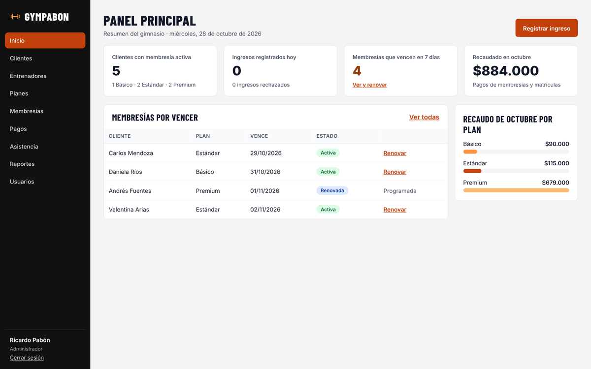
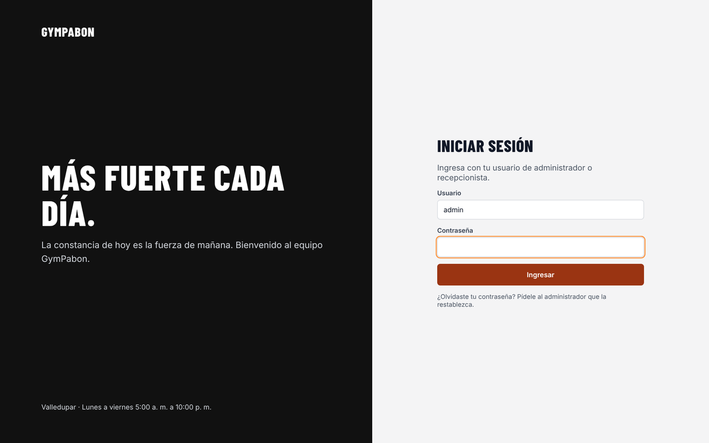
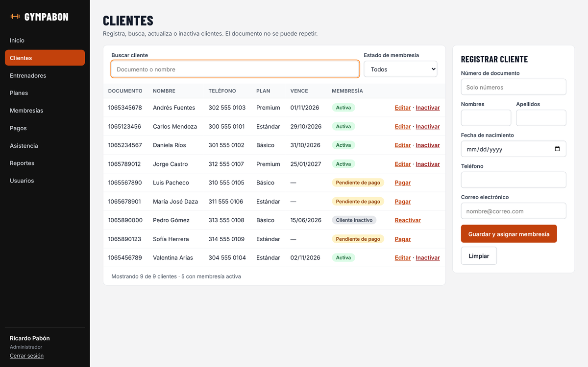
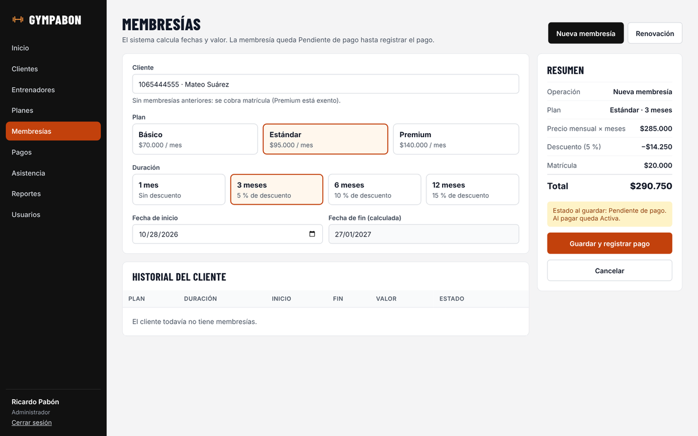
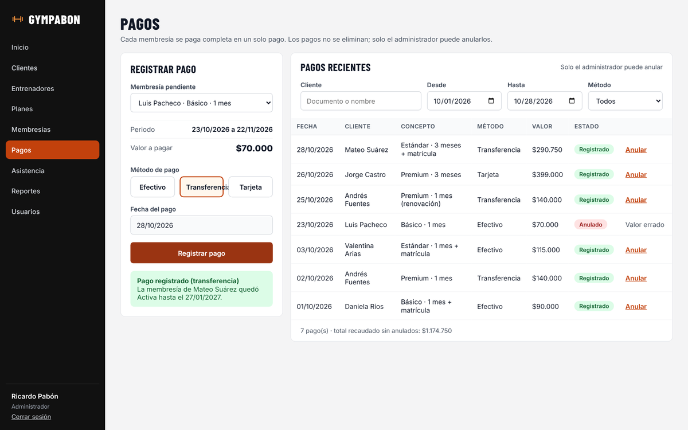
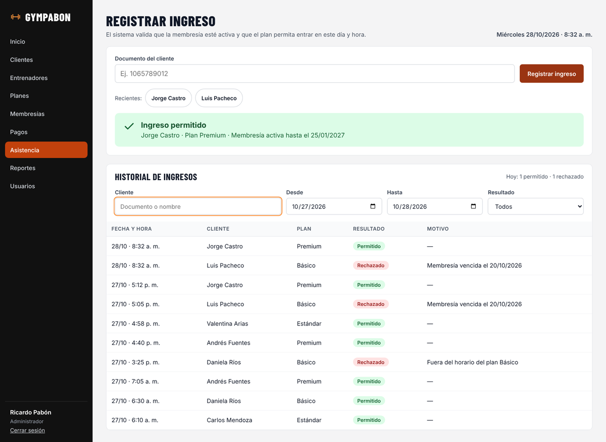

# GymPabon

**Sistema de gestión de clientes, membresías, pagos y asistencia para el gimnasio GymPabon.**

Proyecto de aula de Programación III (SS462) · Programa de Ingeniería de Sistemas · Universidad Popular del Cesar · Valledupar, 2026.
Docente: Ing. Esp. Alfredo Bautista.



## El problema

GymPabon es un gimnasio ficticio de Valledupar que lleva sus clientes, pagos y entradas en cuadernos y hojas de cálculo. Eso causa membresías vencidas que siguen entrando, cobros mal calculados, entrenadores con más clientes de los que pueden atender y ningún dato confiable para tomar decisiones.

GymPabon centraliza todo en un solo sistema: registra clientes, vende y renueva membresías con el valor calculado automáticamente, registra pagos y valida en la puerta que cada cliente tenga una membresía activa y que su plan le permita entrar a esa hora.

## Funcionalidades

| Módulo | Qué permite | Requerimientos |
|---|---|---|
| Inicio de sesión | Entrar con usuario y contraseña; el menú cambia según el rol | RF01 |
| Usuarios | Crear, editar, activar y desactivar cuentas de administrador y recepcionista | RF02 |
| Clientes | Registrar, buscar, editar, inactivar y reactivar clientes y ver el estado de su membresía | RF03, RF04 |
| Entrenadores | Registrar entrenadores, ver sus cupos Premium y asignarlos a clientes Premium | RF05, RF11 |
| Planes | Ver los tres planes y actualizar precio y descripción | RF06 |
| Membresías | Vender y renovar membresías con fechas, descuento, matrícula y total calculados; cancelar con motivo | RF07, RF09, RF10 |
| Pagos | Registrar el pago de una membresía pendiente, consultar pagos y anularlos con motivo | RF08, RF14 |
| Asistencia | Registrar ingresos validando membresía y horario, con el motivo de cada rechazo | RF12, RF13 |
| Panel y reportes | Indicadores del día, membresías por vencer, ingresos por plan y asistencia por día | RF15 |

### Reglas de negocio principales

| Plan | Precio mensual | Matrícula | Horario de acceso | Entrenador |
|---|---|---|---|---|
| Básico | $70.000 | $20.000 | Lunes a viernes, 5:00 a. m. a 3:00 p. m. | No |
| Estándar | $95.000 | $20.000 | Todo el horario del gimnasio | No |
| Premium | $140.000 | Exento | Todo el horario del gimnasio | Sí, asignado |

Horario del gimnasio: lunes a viernes de 5:00 a. m. a 10:00 p. m., sábados de 6:00 a. m. a 6:00 p. m. y domingos de 7:00 a. m. a 1:00 p. m.

- Descuento por duración: 1 mes 0 %, 3 meses 5 %, 6 meses 10 %, 12 meses 15 %.
- La matrícula se cobra solo en la primera membresía del cliente.
- Una renovación empieza el día siguiente al fin de la membresía activa.
- Cada entrenador atiende como máximo 20 clientes Premium.
- Una membresía puede estar Pendiente de pago, Programada, Activa, Vencida o Cancelada. El sistema actualiza los estados solo al arrancar y todos los días a las 00:05.
- Solo el administrador cancela membresías y anula pagos, siempre con un motivo. Los pagos nunca se borran.

## Tecnologías

| Parte | Tecnología |
|---|---|
| Lenguaje y framework | Java 21, Spring Boot 3.3 (API REST, inyección de dependencias), Maven |
| Base de datos | MySQL 8 con JDBC y el patrón DAO (SQL escrito a mano, sin ORM) |
| Interfaz | HTML, CSS y JavaScript servidos por Spring Boot |
| Seguridad | Contraseñas cifradas con PBKDF2 y sal aleatoria, sesión HTTP y permisos por rol |
| Pruebas | JUnit 5 |
| Control de versiones | Git y GitHub |

## Arquitectura

El sistema sigue una arquitectura en tres capas, y cada capa solo llama a la de abajo:

```
Pantallas web (static/)  →  controller  →  service  →  dao  →  MySQL
                            API REST y     reglas de    acceso a datos
                            sesión         negocio      con JDBC
```

- **model:** clases del dominio. `Person` (abstracta) con `Client`, `Trainer` y `User`; `Plan` (abstracta) con `BasicPlan`, `StandardPlan` y `PremiumPlan`, que sobrescriben `canAccess()` y la matrícula; `Membership`, `Payment` y `Attendance`.
- **dao:** `GenericDAO<T, ID>` con las operaciones CRUD y una interfaz por entidad. **dao.impl** las implementa con JDBC y `PreparedStatement`.
- **service:** reglas de negocio: precios, renovación, cupos, horarios y pagos dentro de una transacción.
- **controller:** endpoints REST, DTO y manejo global de errores (`ApiExceptionHandler`).
- **exception** y **util:** excepciones propias, conexión a la base de datos y cifrado de contraseñas.

## Estructura del repositorio

```
database/
  schema.sql              tablas, llaves y restricciones
  seed.sql                datos de prueba
backend/
  pom.xml
  src/main/java/com/gympabon/
    model/  dao/  dao/impl/  service/  controller/  controller/dto/  exception/  util/
  src/main/resources/
    application.properties
    application-local.properties.example
    static/               pantallas web (html, css, js y fuentes)
  src/test/java/com/gympabon/
    fake/                 DAO en memoria para las pruebas
    model/  service/      pruebas JUnit 5
docs/                     documentos y capturas del proyecto
```

## Cómo ejecutarlo

**Requisitos:** JDK 21, MySQL 8 y Maven (IntelliJ IDEA ya lo trae incluido).

1. **Crear la base de datos.** En MySQL Workbench o en la consola, ejecutar primero `database/schema.sql` y después `database/seed.sql`.
2. **Configurar las credenciales.** Copiar `backend/src/main/resources/application-local.properties.example` como `application-local.properties` en la misma carpeta y escribir el usuario y la contraseña de MySQL. Este archivo no se sube a Git.
3. **Ejecutar.** Abrir la carpeta `backend` en IntelliJ IDEA y correr `GymPabonApplication`, o desde una terminal dentro de `backend`:
   ```
   mvn spring-boot:run
   ```
4. **Abrir** http://localhost:8080.

### Usuarios de prueba

Contraseña de todos: `GymPabon2026`

| Usuario | Rol | Acceso |
|---|---|---|
| `admin` | Administrador | Todo, incluidos usuarios, reportes, planes, cancelaciones y anulaciones |
| `kortiz` | Recepcionista | Clientes, membresías, pagos y asistencia |
| `lmejia` | Recepcionista | Clientes, membresías, pagos y asistencia |

Para probar la asistencia: el documento `1065789012` (Jorge Castro, Premium) entra; el `1065567890` (Luis Pacheco) es rechazado y el sistema muestra el motivo.

## Pruebas

En IntelliJ: clic derecho sobre `backend/src/test/java` → *Run 'All Tests'*. Desde una terminal dentro de `backend`:

```
mvn test
```

Son 74 pruebas unitarias de los servicios y del modelo. No necesitan MySQL: el paquete `com.gympabon.fake` trae versiones en memoria de los DAO que implementan las mismas interfaces.

## API

Todas las rutas empiezan por `/api` y responden JSON. Salvo el inicio de sesión, requieren una sesión activa.

| Recurso | Rutas principales |
|---|---|
| Sesión | `POST /auth/login`, `POST /auth/logout`, `GET /auth/me` |
| Clientes | `GET /clients?q=`, `POST /clients`, `PUT /clients/{id}`, `PATCH /clients/{id}/deactivate`, `PATCH /clients/{id}/activate` |
| Entrenadores | `GET /trainers`, `GET /trainers/available`, `POST /trainers`, `PUT /trainers/{id}`, `PATCH /trainers/{id}/deactivate`, `PATCH /trainers/{id}/activate` |
| Usuarios | `GET /users`, `POST /users`, `PUT /users/{id}`, `PATCH /users/{id}/deactivate`, `PATCH /users/{id}/activate` |
| Planes | `GET /plans`, `PUT /plans/{id}` |
| Membresías | `GET /memberships?clientId=`, `GET /memberships/quote`, `POST /memberships`, `POST /memberships/renew`, `PATCH /memberships/{id}/cancel`, `PATCH /memberships/{id}/trainer` |
| Pagos | `GET /payments/pending`, `GET /payments?from=&to=&method=`, `POST /payments`, `PATCH /payments/{id}/void` |
| Asistencia | `POST /attendance`, `GET /attendance?from=&to=`, `GET /attendance/client/{id}` |
| Reportes | `GET /reports/dashboard`, `GET /reports/expiring`, `GET /reports/income-by-plan`, `GET /reports/clients-by-plan`, `GET /reports/attendance-by-day` |

## Capturas

| Inicio de sesión | Clientes |
|---|---|
|  |  |

| Membresías | Pagos |
|---|---|
|  |  |



## Equipo

| Integrante | Rol | Responsabilidades |
|---|---|---|
| Juan Manuel Otero Rueda | Líder | Proyecto base, clientes, entrenadores, usuarios, inicio de sesión y permisos |
| Geovanny Santiago Pino Avendaño | Desarrollador | Base de datos, conexión, GenericDAO, planes y membresías |
| Juan Diego Pabón Ortiz | Desarrollador | Pagos, asistencia, reportes y plantilla de las pantallas |

## Flujo de trabajo con Git

- `main` guarda la versión entregada y `develop` integra el trabajo.
- Cada parte se desarrolla en una rama `feature/...` creada desde `develop` y entra por un pull request revisado por otro integrante.
- Los commits van en inglés con su tipo: `feat:`, `fix:`, `test:`, `docs:`.

## Uso de herramientas de inteligencia artificial

Durante el proyecto el equipo usó Claude (Anthropic) como asistente de programación: apoyó en la generación de código a partir del diseño del proyecto, en la redacción de documentación y en la revisión de errores.

El equipo tomó las decisiones del proyecto, revisó y probó cada parte antes de integrarla, y gestionó el repositorio con ramas por funcionalidad, commits propios y pull requests revisados por los integrantes.
